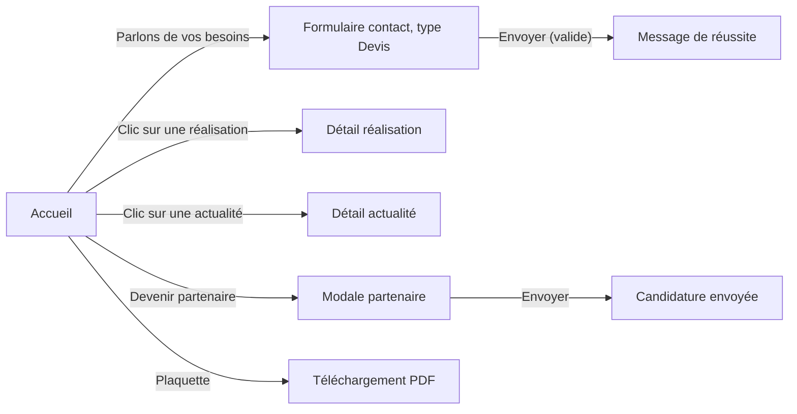

# 03 — App Flow : parcours du site

> Découle des user stories du PRD.

## Points d'entrée
- Accueil `/` (recherche Google, lien direct, carte de visite).
- Liens profonds vers une réalisation, une actualité ou un événement (partage sur les réseaux).
- Version anglaise (URL selon TRD Q3).

## Écrans
| Écran | À quoi il sert | Données nécessaires | User stories |
|---|---|---|---|
| Accueil `/` | Présenter ICES dans l'ordre validé (PRD F1) | `content/<langue>/home.ts` | US1, US2, US4, US9 |
| Expertises `/prestations` | Détailler les domaines d'expertise | `prestations.ts` | — |
| Réalisations `/realisations` | Lister les missions | liste des réalisations | US5 |
| Détail réalisation `/realisations/:slug` | Décrire une mission | une réalisation | US5 |
| Actualités & Événements `/actualites` | Lister actualités et événements | liste des publications | US6 |
| Détail `/actualites/:slug` | Lire une actualité ou un événement | une publication | US6 |
| À propos `/a-propos` | Qui sommes-nous, vision Horizon, équipe | `about.ts` | US7 |
| Contact (bloc partagé en bas de chaque page) | Demande de devis / d'information | `contact.ts` | US2 |
| Modale Devenir partenaire | Candidature partenaire | `contact.ts` (partner) | US3 |

## Ordre de la landing (validé le 22/10)
| Position | Couleur | Section |
|---|---|---|
| 1 | blanc | Hero |
| 2 | bleu (dôme sur le hero, figée) | Nos cibles |
| 3 | blanc (dôme) | Vision & valeurs |
| 4 | bleu (dôme) | Nos offres |
| 5 | bleu | Nos interlocuteurs |
| 6 | bleu | Notre approche |
| 7 | bleu | Missions & Réalisations |
| 8 | blanc | Actualités & Événements |
| 9 | blanc | Équipe, clients & partenaires, implantation |
| — | — | Contact, pied de page |

## Parcours principal

## Parcours alternatifs
- **Annuler** : fermer la modale partenaire (croix, Échap, clic hors modale) ; la saisie est perdue.
- **Modifier** : après une erreur d'envoi, la saisie reste dans le formulaire pour corriger et renvoyer.
- **Revenir** : depuis un détail, le bouton retour du navigateur et le lien « Retour » ramènent à la liste ou à la landing, à la position de défilement précédente.
- **Passer** : les ancres du menu (`/#offres`, `/#realisations`…) sautent directement à une section.

## Actions, avec tous leurs états
| Action | Déclencheur | Validation | Chargement | Réussite | Erreur | Écran suivant |
|---|---|---|---|---|---|---|
| Envoyer le formulaire de contact | bouton « Envoyer » | prénom, nom, email valides, message, consentement coché | bouton désactivé + indicateur | « Message envoyé. Nous revenons vers vous sous 48 heures ouvrées. » | message générique, saisie gardée | même écran |
| Envoyer la candidature partenaire | bouton de la modale | entreprise, secteur, taille, prénom, nom, email, consentement | bouton désactivé | « Candidature envoyée » dans la modale | message générique, saisie gardée | modale |
| Télécharger la plaquette | lien de la section Nos offres | — | — | PDF téléchargé | sans objet (fichier versionné, vérifié au build) | même écran |
| Changer de langue | bouton FR / EN | — | — | même page dans l'autre langue | — | même page |
| Ouvrir une réalisation / actualité | clic sur une carte | slug existant | — | page de détail | slug inconnu → page « introuvable » avec lien vers la liste | détail |

## Navigation
- **Menu** : Accueil, Expertises, Réalisations, Actualités & Événements, À propos, Contact ; bouton « Devenir partenaire » ; sélecteur FR / EN.
- **Bouton retour** : navigateur ; lien « Retour » sur les pages de détail.
- **Liens profonds** : chaque réalisation et publication a une URL partageable.

## États vides ou bloqués
- **Aucune donnée** : liste de réalisations ou d'actualités vide → texte « Bientôt disponible » et lien vers le contact ; la section correspondante de la landing est masquée si la liste est vide.
- **Permission refusée** : sans objet (site public).
- **Hors ligne** : page d'erreur du navigateur ; un envoi de formulaire hors ligne affiche l'erreur générique et garde la saisie.

## Première utilisation
- **Accueil (onboarding)** : sans objet.
- **Création de compte** : sans objet.

## Questions reportées
> Validées comme reportées par l’utilisateur le 22/10/2026 (« je valide les six documents »). Chaque question se tranche avant la tâche qui en dépend (06-implementation-plan.md) ; le document repasse alors en brouillon jusqu’à revalidation.
- Q1 — Le menu ci-dessus convient-il (et Formation / Publications : PRD Q2) ?
- Q2 — Événements à venir et passés dans la même liste que les actualités, avec un filtre par type ?

## Historique
| Version | Date | Changement | Validé par |
|---|---|---|---|
| 0.1 | 2026-10-22 | Création | — |
| 1.0 | 2026-10-22 | Validé par l’utilisateur, questions reportées | Fabrice |
