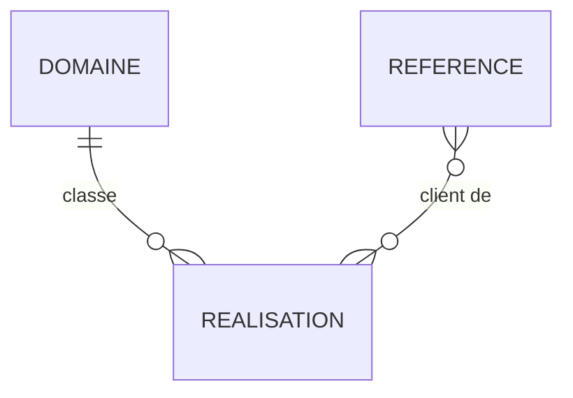

# 05 — Schéma backend

> **Pas de base de données en V1** : le site est statique, avec une seule fonction serveur, `POST /api/demande` (TRD), qui valide et transmet les formulaires par e-mail sans rien stocker. Ce document décrit donc (1) les structures de contenu versionnées dans `src/content/<langue>`, (2) les corps JSON reçus par `/api/demande`. Si un CMS est retenu (TRD Q5), ce document sera repris avant toute création de table.

## Entités
| Entité | Ce qu'elle représente |
|---|---|
| Réalisation | Une mission menée par ICES (page de détail `/realisations/:slug`) |
| Publication | Une actualité ou un événement (page de détail `/actualites/:slug`) |
| Membre d'équipe | Une personne présentée dans la section Équipe et la page À propos |
| Référence | Un client ou un partenaire (logo dans la bande) |
| Demande de contact | Données du formulaire de contact / devis, transmises au service, non stockées par le site |
| Candidature partenaire | Données de la modale « Devenir partenaire », transmises au service, non stockées par le site |
| Demande de campagne | Données d'un des 6 formulaires « Précisez votre besoin » des pages `/campagne/<sujet>` (ICES Emailing), non stockées par le site |

## Tables ou collections

### Réalisation (fichier `realisations.ts`, une entrée par langue)
| Champ | Type | Obligatoire | Valeur par défaut | Index |
|---|---|---|---|---|
| slug | texte, minuscules et tirets, identique en FR et EN | oui | — | oui (unique) |
| titre | texte | oui | — | non |
| client | texte | non | — | non |
| pays | texte | oui | — | non |
| annee | nombre (AAAA) | non | — | non |
| domaine | identifiant d'un domaine de `prestations.ts` | non | — | non |
| resume | texte court (carte) | oui | — | non |
| corps | paragraphes | oui | — | non |
| image | chemin d'image (WebP) + `alt` | oui | — | non |
| galerie | liste d'images + `alt` | non | liste vide | non |

### Publication (fichier `actualites.ts`)
| Champ | Type | Obligatoire | Valeur par défaut | Index |
|---|---|---|---|---|
| slug | texte, unique | oui | — | oui (unique) |
| type | `actualite` ou `evenement` | oui | `actualite` | non |
| date | date ISO `AAAA-MM-JJ` | oui | — | tri décroissant |
| lieu | texte (événements) | non | — | non |
| titre | texte | oui | — | non |
| resume | texte court | oui | — | non |
| corps | paragraphes | oui | — | non |
| image | chemin + `alt` | oui | — | non |

### Membre d'équipe
| Champ | Type | Obligatoire | Valeur par défaut | Index |
|---|---|---|---|---|
| nom | texte | oui | — | non |
| fonction | texte | oui | — | non |
| photo | chemin + `alt` | oui | — | non |

### Référence
| Champ | Type | Obligatoire | Valeur par défaut | Index |
|---|---|---|---|---|
| nom | texte | oui | — | non |
| genre | `client` ou `partenaire` | oui | — | non |
| logo | chemin (SVG ou PNG) | oui | — | non |
| lien | URL | non | — | non |

### Demande de contact (corps JSON envoyé, champ `formulaire: "contact"`)
| Champ | Type | Obligatoire | Valeur par défaut | Index |
|---|---|---|---|---|
| prenom | texte ≤ 80 | oui | — | — |
| nom | texte ≤ 80 | oui | — | — |
| pays | texte ≤ 80 | non | — | — |
| telephone | texte ≤ 30 | non | — | — |
| email | email valide | oui | — | — |
| type | Conseil, Devis, Partenariat, Formation, Autre | non | Devis depuis « Parlons de vos besoins » | — |
| message | texte ≤ 5000 | oui | — | — |
| consentement | booléen vrai | oui | — | — |

### Candidature partenaire (champ `formulaire: "partenaire"`)
| Champ | Type | Obligatoire | Valeur par défaut | Index |
|---|---|---|---|---|
| entreprise | texte ≤ 120 | oui | — | — |
| secteur | liste fermée | oui | — | — |
| taille | liste fermée | oui | — | — |
| prenom, nom | texte ≤ 80 | oui | — | — |
| email | email valide | oui | — | — |
| telephone | texte ≤ 30 | non | — | — |
| site | URL | non | — | — |
| motivation | texte ≤ 5000 | non | — | — |
| consentement | booléen vrai | oui | — | — |

### Demande de campagne (champ `formulaire: "besoin-01"` à `"besoin-06"`)
| Champ | Type | Obligatoire | Valeur par défaut | Index |
|---|---|---|---|---|
| sujet | texte ≤ 200 (libellé du bouton de l'e-mail) | oui | — | — |
| nom | texte ≤ 120 | oui | — | — |
| fonction | texte ≤ 120 | non | — | — |
| organisation | texte ≤ 120 | oui | — | — |
| pays | texte ≤ 80 | oui | — | — |
| email | email valide | oui | — | — |
| telephone | texte ≤ 30 | non | — | — |
| consentement | `on` | oui | — | — |
| champs du sujet | textes ≤ 5000 ou listes de choix, définis par formulaire dans `ICES EMAILING/docs/05-backend-schema.md` | selon le formulaire | — | — |

Pour ces six formulaires, la fonction vérifie les champs communs ci-dessus ; les champs propres au sujet sont acceptés s'ils sont des textes (ou listes de textes) de 5000 caractères au plus, et recopiés dans l'e-mail.

### Règles communes à tous les formulaires
- `formulaire` doit être `contact`, `partenaire` ou `besoin-01` à `besoin-06`, sinon refus.
- Champ piège `site` (formulaires de campagne) ou `website` (formulaires du site, à ajouter) : s'il est rempli, la fonction répond comme un succès mais n'envoie rien.
- Corps JSON de 20 Ko au plus.

## Relations

## Propriété des données
- Contenus : ICES, versionnés dans le dépôt.
- Demandes et candidatures : ICES, reçues par e-mail dans contact@ices-consulting.com ; Resend ne sert qu'à l'envoi.

## Authentification
- **Inscription / connexion / réinitialisation** : sans objet.
- **Durée de session** : sans objet.

## Droits d'accès
| Entité | Lire | Créer | Modifier | Supprimer |
|---|---|---|---|---|
| Contenus (réalisations, publications, équipe, références) | public | équipe technique (commit) | équipe technique | équipe technique |
| Demandes / candidatures / demandes de campagne | ICES (boîte contact@) | visiteur (envoi par `/api/demande`) | — | ICES |

## Validation des données
- Dans le navigateur : champs obligatoires, format email, longueurs maximales ci-dessus, consentement coché.
- Côté serveur (`api/demande.ts`) : les mêmes règles sont revérifiées, plus les règles communes ci-dessus (SEC-5) ; le site ne fait pas confiance à la validation du navigateur.
- Contenus : un script de contrôle (`npm run test:content`) vérifie les slugs uniques, les champs obligatoires et l'existence des images, en FR comme en EN.

## Conservation et suppression
- Le site ne conserve aucune donnée personnelle.
- Durée de conservation dans la boîte contact@ : à fixer par ICES et à indiquer dans la mention de consentement (Q1 ci-dessous).

## Migrations et données initiales
- Données initiales : réalisations, actualités et équipe déjà présentes dans `home.ts` (sections de la landing), reprises dans les nouveaux fichiers.

## Questions reportées
> Validées comme reportées par l’utilisateur le 22/10/2026 (« je valide les six documents »). Chaque question se tranche avant la tâche qui en dépend (06-implementation-plan.md) ; le document repasse alors en brouillon jusqu’à revalidation.
- Q1 — Durée de conservation des demandes et adresse de contact RGPD à afficher.
- Q2 — Les références (logos) peuvent-elles être affichées publiquement (accord des clients et partenaires) ?

## Historique
| Version | Date | Changement | Validé par |
|---|---|---|---|
| 0.1 | 2026-10-22 | Création | — |
| 1.0 | 2026-10-22 | Validé par l’utilisateur, questions reportées | Fabrice |
| 1.1 | 2026-10-31 | Fonction `/api/demande` ; demandes de campagne ICES Emailing ; règles communes | Fabrice |
